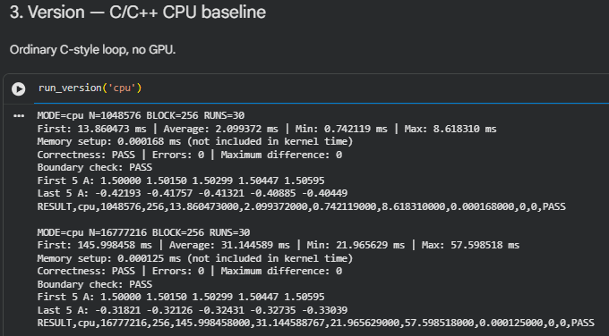
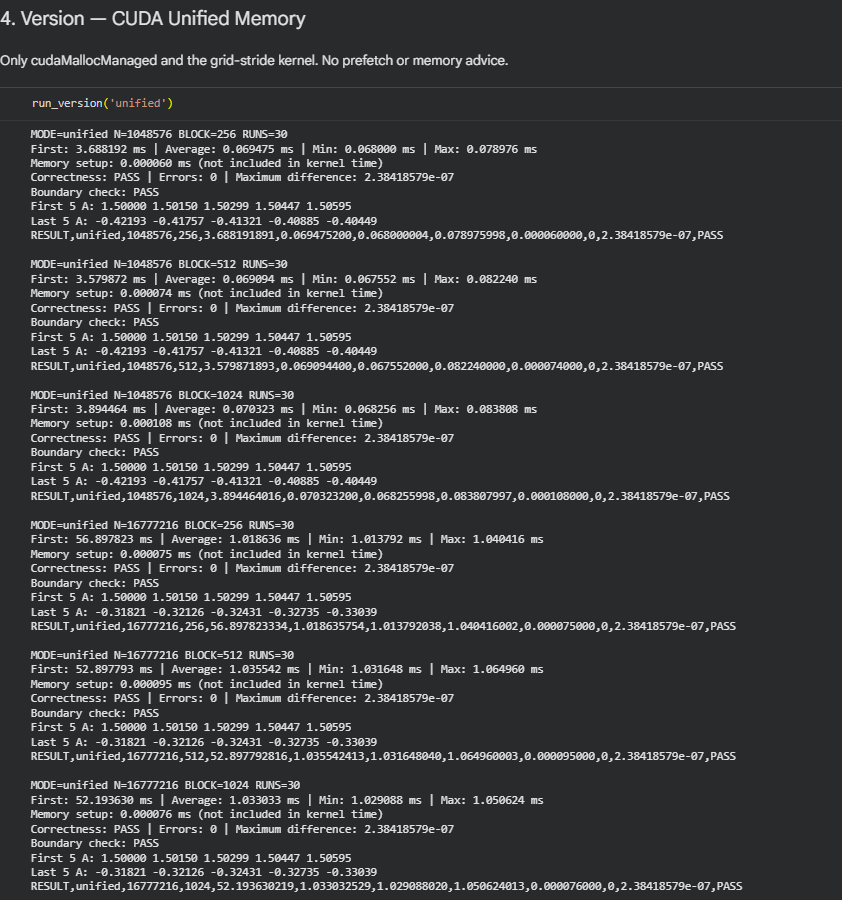
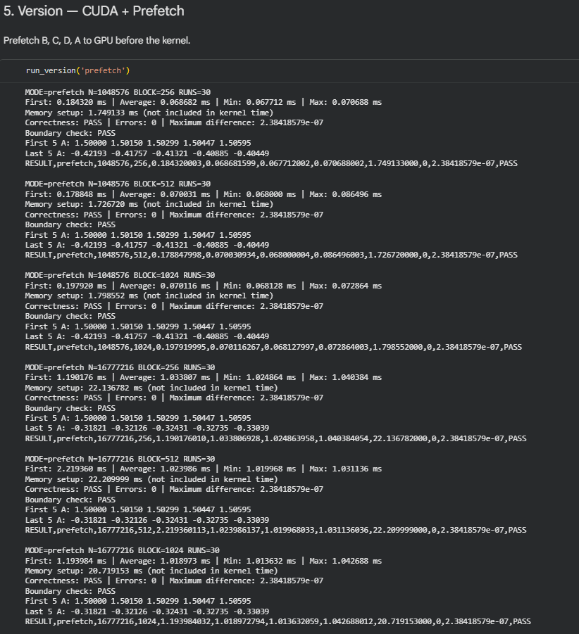
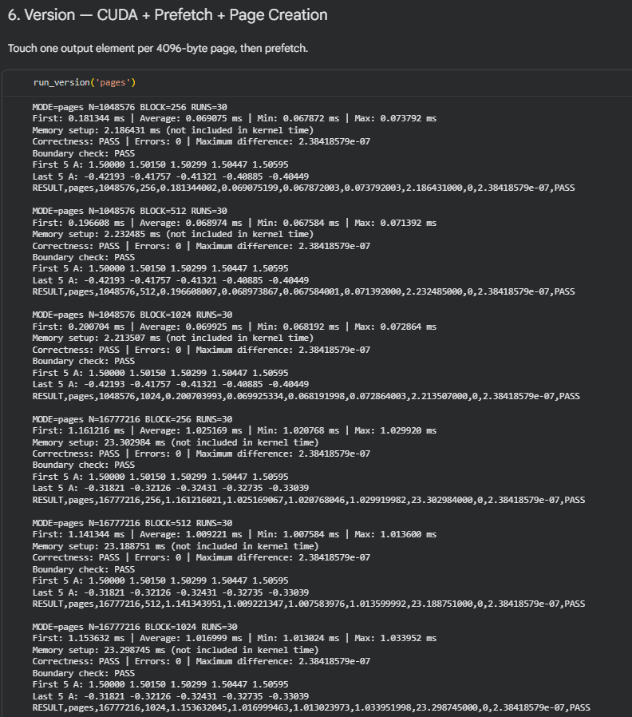
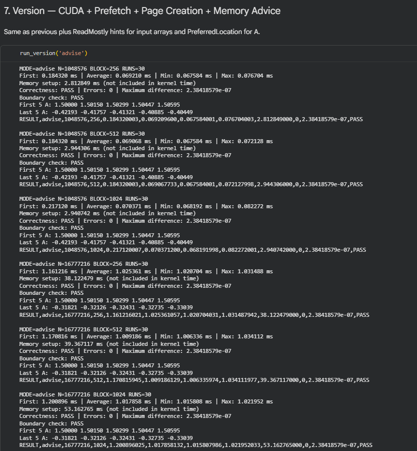
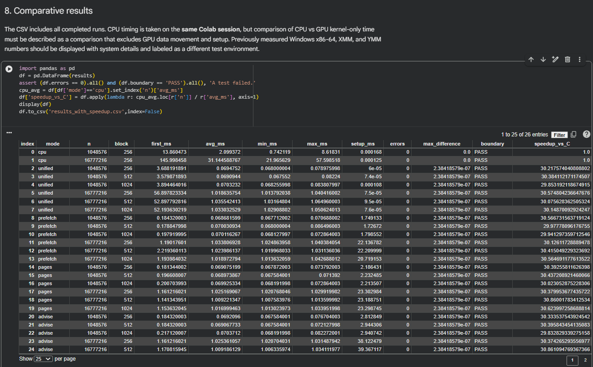
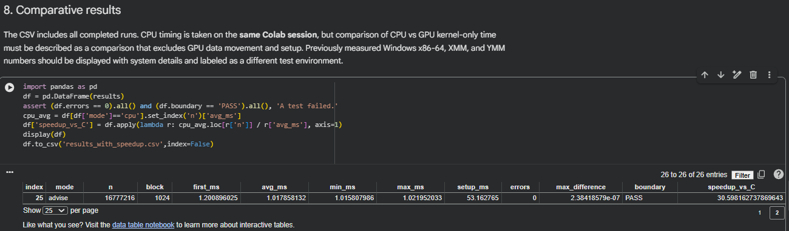
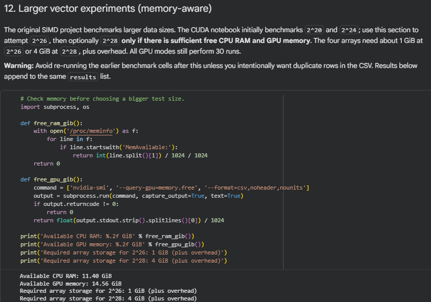
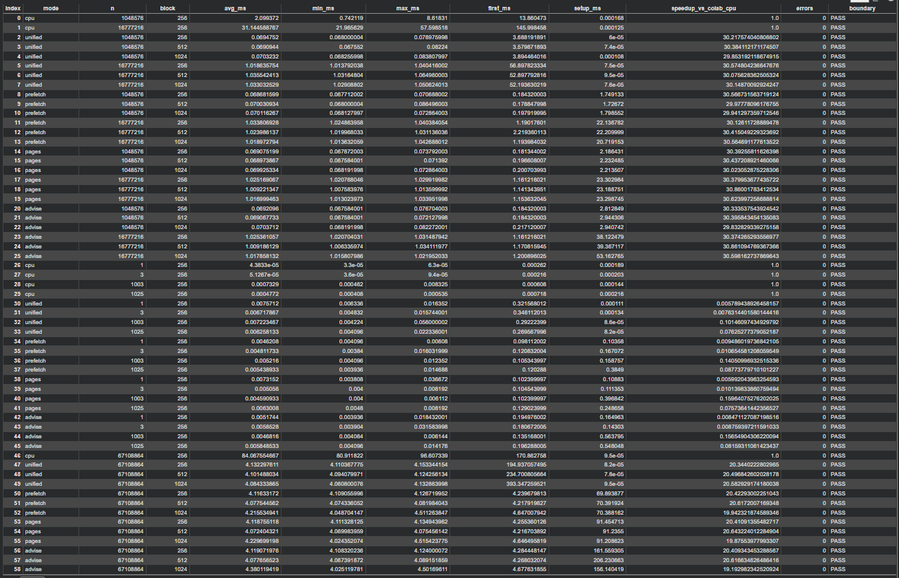
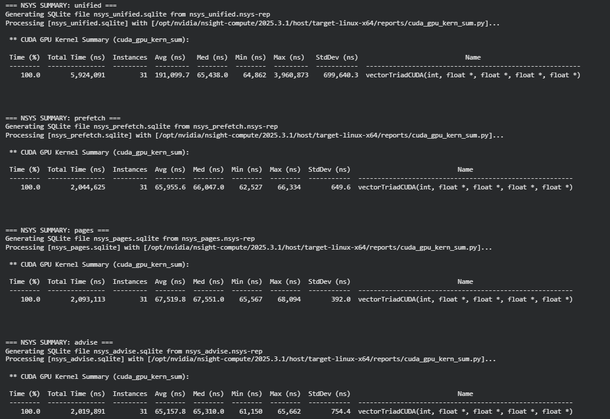

# CEPARCO — CUDA Vector Triad (Deep Dive: CUDA Concept and Programming)

**Section:** S01  
**Submission:** GitHub repository with an accessible Google Colab notebook  
**Colab link:** https://colab.research.google.com/drive/10htYJpWGbe8PPoKBAHhRhe6KqZIGYhUG?usp=sharing

## 0. Group Members, Project Specifications, and AI Usage Declaration

### 0.1 Group members
Saoud Abdulrahman, Justin Lance Lim, Kent Xavier Lopez, Francis Medin Nicolas 

### 0.2 Project specifications

The project extends the group's earlier SIMD vector-triad assignment to CUDA. For `n` single-precision (`float`) elements, calculate:

\[
A[i] = B[i] + C[i] \times D[i], \quad 0 \le i < n
\]

The input initialization is carried over from the original project:

```cpp
B[i] = sin(i * 0.001);
C[i] = cos(i * 0.002);
D[i] = sin(i * 0.0005) + 1.5;
```

**Five required versions:**

| Version | Implementation | Prefetch? | Page creation/touching? | Memory advice? |
|---|---|---|---|---|
| 1 | C/C++ CPU baseline | No | No | No |
| 2 | CUDA grid-stride loop using Unified Memory | No | No | No |
| 3 | CUDA grid-stride loop with prefetch | Yes | No | No |
| 4 | CUDA grid-stride loop with prefetch + page creation | Yes | Yes* | No |
| 5 | CUDA grid-stride loop with prefetch + page creation + memory advice | Yes | Yes* | Yes |


All GPU variants run the same kernel:

```cpp
__global__ void vectorTriadCUDA(int n, float *A, float *B,
                                float *C, float *D) {
    int index = blockIdx.x * blockDim.x + threadIdx.x;
    int stride = blockDim.x * gridDim.x;

    for (int i = index; i < n; i += stride) {
        A[i] = B[i] + C[i] * D[i];
    }
}
```

The experiments use 256, 512 and 1024 threads per block; vector sizes `2^20`, `2^24` and `2^26`; and **30 timed runs per configuration**, excluding the separately reported first launch. `2^28` and `2^30` were **not run** in the submitted measurement set.

**Correctness checks:** Compare GPU results with C reference calculations using an approximately `1e-5` relative-scaled tolerance. Display the first and last five elements of A. Check non-power-of-two and small sizes `n = 1, 3, 1003, 1025`, using 16 sentinel elements beyond output A to detect out-of-bounds writes. All recorded main-case and boundary checks passed; the largest reported main-case difference is approximately `2.38418579e-7`.

### 0.3 Execution environment and timing method

| Setting | Recorded value / required action |
|---|---|
| CUDA environment | Google Colab, NVIDIA GPU — **[INSERT ACTUAL GPU MODEL FROM `!nvidia-smi`]** |
| Colab CPU | **[INSERT CPU MODEL FROM `!lscpu`]** |
| Toolkit | **[INSERT CUDA VERSION FROM `!nvcc --version`]** |
| Earlier SIMD environment | Windows + Visual Studio Debug and Release; **[INSERT CPU/COMPILER DETAILS IF AVAILABLE]** |
| GPU timing | CUDA events, GPU kernel portion only |
| CPU timing | Host steady clock, C loop portion only |
| Reported values | 30-run average, minimum, maximum; first launch reported separately |
| GPU setup | The `setup_ms` field excludes initialization and CPU page touching; **it is not total startup or end-to-end time** |

Because the Windows SIMD measurements and Colab CUDA measurements were taken on different hardware and operating environments, they are presented together only for **context**, not as a controlled cross-platform speedup.

### 0.4 AI usage declaration

> ChatGPT was used to assist with drafting/simplifying the CUDA implementations, troubleshooting CUDA API version differences, organizing the Colab tests, and drafting the report. The group ran the software, obtained the measurements and profiler logs, and is responsible for checking and approving the submitted source and discussion. **Edit this declaration to match everyone's actual usage before submitting.

---

## i. Screenshots of Program Output with Correctness Check AND Execution Time for All Cases

All figures below are genuine screenshots captured from the group's Colab outputs. Each execution displays `MODE`, vector size, block size, 30-run execution time statistics, correctness result, boundary status, and the beginning/end of output A. Tables in Section iii provide readable numeric results.

### i.a C/C++ version



### i.b CUDA Unified Memory — no prefetch / no memory advice



### i.c CUDA with prefetch



### i.d CUDA with prefetch and page touching (experimental page-creation interpretation)



### i.e CUDA with prefetch, page touching, and memory advice



### i.f Comparative output and larger vector tests









### i.g Boundary correctness screenshots

Boundary tests covered `n = 1, 3, 1003, 1025` for all five versions (20 combinations). All reported `Correctness` and `Boundary check` values were `PASS`. Test output is retained in [`benchmark_and_profiler_console_log.txt`](benchmark_and_profiler_console_log.txt) and the notebook.

**[INSERT GENUINE SCREENSHOT(S) OF SECTION 9 BOUNDARY TEST RESULTS HERE]**

---

## ii. Screenshots of Nsight Systems (`nsys`) for All CUDA Variants

All four `nsys` runs completed and generated `.nsys-rep` files. The 31 kernel instances per run include the first launch plus 30 additional launches. The table summarizes the most recent run logged in `benchmark_and_profiler_console_log.txt`.

| CUDA variant | Recorded kernel instances | Median kernel (µs) | Mean including first (µs) |
|---|---:|---:|---:|
| Unified Memory | 31 | 65.438 | 191.100 |
| Prefetch | 31 | 66.047 | 65.956 |
| Prefetch + Pages | 31 | 67.551 | 67.520 |
| Prefetch + Pages + Advice | 31 | 65.310 | 65.158 |

The higher Unified mean results largely from the slow initial launch; the median better represents the typical launch in that profile. Nsight Compute (`ncu`) also produced one report per CUDA variant, but its instrumentation affects run times, so its timing output is **not** substituted into the ordinary benchmark table.

### Nsight Systems Profiling Results


---

## iii. Comparative Table of Execution Times (C, CUDA Variants, x86-64, XMM, YMM)

### iii.a Colab: all five versions, 256 threads/block

All numbers are **30-run average kernel/loop time in milliseconds**. Lower is better. CUDA times exclude prefetch/migration preparation and other setup.

| Implementation | `2^20` (ms) | `2^24` (ms) | `2^26` (ms) |
|---|---:|---:|---:|
| C/C++ (Colab) | 2.0994 | 31.1446 | 84.0676 |
| CUDA Unified | 0.0695 | 1.0186 | 4.1323 |
| CUDA Prefetch | 0.0687 | 1.0338 | 4.1163 |
| CUDA Prefetch + Pages | 0.0691 | 1.0252 | 4.1188 |
| CUDA Prefetch + Pages + Advice | 0.0692 | 1.0254 | 4.1191 |

### iii.b All block sizes at `2^26` (ms)

| CUDA variant | 256 | 512 | 1024 |
|---|---:|---:|---:|
| Unified | 4.1323 | 4.1015 | 4.0843 |
| Prefetch | 4.1163 | 4.0775 | 4.2155 |
| Prefetch + Pages | 4.1188 | 4.0724 | 4.2297 |
| Prefetch + Pages + Advice | 4.1191 | 4.0777 | 4.3801 |

### iii.c Historical SIMD experiment: Windows Visual Studio **Release** (ms)

| n | C | x86-64 assembly | SIMD XMM (128-bit) | SIMD YMM (256-bit) |
|---|---:|---:|---:|---:|
| `2^20` | 0.2288 | 0.4212 | 0.2374 | 0.1930 |
| `2^26` | 32.2542 | 35.4736 | 30.7271 | 33.9873 |
| `2^29` | 245.5390 | 264.0704 | 242.5343 | 241.2624 |

**Important:** The Windows CPU and Colab CPU rows are separate baselines. A number computed by dividing a Windows SIMD time by a Colab CUDA time **would not** be a fair processor-to-processor speedup. SIMD Debug results and further Windows screenshots remain in [`SIMD_original_README.md`](SIMD_original_README.md).

### iii.d Same-session Colab speedup relative to its C baseline

Speedup is calculated as `average Colab C time / average CUDA kernel time`, not as full-program throughput.

| CUDA variant | `2^20` | `2^24` | `2^26` |
|---|---:|---:|---:|
| Unified | 30.22× | 30.57× | 20.34× |
| Prefetch | 30.57× | 30.13× | 20.42× |
| Prefetch + Pages | 30.39× | 30.38× | 20.41× |
| Prefetch + Pages + Advice | 30.33× | 30.37× | 20.41× |

The raw collected averages are in [`measured_benchmarks.csv`](measured_benchmarks.csv). The full notebook also exports the experimental result table from the Colab session.

### iii.e `2^26` detailed CUDA timings — average / minimum / maximum (ms)

These values come from the **30 timed runs** in `DATA.txt`, not the profiler-instrumented runs.

| CUDA variant | Threads/block | Average (ms) | Minimum (ms) | Maximum (ms) |
|---|---:|---:|---:|---:|
| Unified | 256 | 4.1323 | 4.1104 | 4.1533 |
| Unified | 512 | 4.1015 | 4.0941 | 4.1243 |
| Unified | 1024 | 4.0843 | 4.0608 | 4.1329 |
| Prefetch | 256 | 4.1163 | 4.1091 | 4.1267 |
| Prefetch | 512 | 4.0775 | 4.0743 | 4.0820 |
| Prefetch | 1024 | 4.2155 | 4.0487 | 4.5113 |
| Pages | 256 | 4.1188 | 4.1113 | 4.1349 |
| Pages | 512 | 4.0724 | 4.0700 | 4.0755 |
| Pages | 1024 | 4.2297 | 4.0244 | 4.5154 |
| Advise | 256 | 4.1191 | 4.1083 | 4.1240 |
| Advise | 512 | 4.0777 | 4.0674 | 4.0892 |
| Advise | 1024 | 4.3801 | 4.0251 | 4.5017 |

---

## iv. Analysis of Results

### iv.a Kernel execution time

For the largest tested size, `2^26`, the Colab C baseline averaged **84.0676 ms**, whereas the CUDA implementations averaged about **4.08–4.38 ms** across the measured block sizes. At 256 threads per block, CUDA Prefetch averaged **4.1163 ms**, corresponding to approximately **20.4× lower measured computation time** than the Colab C baseline. This does **not** include GPU allocation, prefetching, CPU page touching, data movement, or result reading, and therefore should not be called an end-to-end application speedup.

The CUDA variants use the **same arithmetic and grid-stride kernel**. Their warmed kernel times are consequently close. The first launch differs more strongly. For example, at `2^26` and block size 256, Unified's first reported launch was **194.94 ms**, versus **4.24 ms** for Prefetch. This difference is consistent with memory-residency and initial-launch effects; explicit prefetching shifts some preparation work to the period before launch.

| Version, `2^26`, 256 threads | First launch (ms) | Reported setup (ms) | 30-run avg (ms) |
|---|---:|---:|---:|
| Unified | 194.9371 | 0.0001 | 4.1323 |
| Prefetch | 4.2397 | 69.8939 | 4.1163 |
| Prefetch + Pages | 4.2554 | 91.4547 | 4.1188 |
| Prefetch + Pages + Advice | 4.2844 | 161.5593 | 4.1191 |

The reported setup figure omits initialization and page-touching cost. No full end-to-end times were measured, so the table is **not** evidence that one complete implementation is globally fastest.

### iv.b Speed performance across C, x86-64, XMM, YMM and CUDA

Our historical Windows Release results show that explicit SIMD did not consistently beat the C compiler. At `2^20`, YMM was fastest (0.1930 ms); at `2^26`, XMM was fastest (30.7271 ms); at `2^29`, YMM slightly beat XMM (241.2624 vs. 242.5343 ms, around 0.5%). The x86-64 scalar assembly version took **0.4212 ms** versus **0.2288 ms** for C at `2^20`—approximately **84% longer**. The proposition that Release C was auto-vectorized is plausible, but has **not** been verified using compiler output.

CUDA provides many GPU threads for independent array elements. Our Colab computation-only results are faster than the **Colab CPU** baseline for the larger tested vectors. Because the Windows and Colab measurements use different systems, these results do not prove CUDA is universally faster than optimized XMM/YMM on the same hardware.

### iv.c Professor's guide questions

**a) How does block size affect execution time across different vector sizes and maximum blocks? Which block size do you recommend?**

Block size changes the number of threads within a CUDA block and affects the grid configuration and how the GPU schedules available work. Larger blocks are not automatically faster. In our `2^26` experiments, **512 threads/block** was fastest for Prefetch (**4.0775 ms**), Pages (**4.0724 ms**), and Advice (**4.0777 ms**); Unified was fastest with **1024 threads/block** (**4.0843 ms**). In the smaller `2^20` and `2^24` experiments, the differences were generally smaller and varied by version. Therefore, we recommend **512 threads/block** as a stable overall choice for this workload and GPU session, not a universally optimal setting. The experiment tested block sizes 256, 512, and 1024; it did not prove that every possible grid/block count is optimal or fully investigate a hardware-specific maximum grid configuration.

**b) Is prefetching always recommended, or should CUDA manage memory? Give examples where each is better.**

**Prefetching is not always better.** When inputs are initialized on the CPU and will be used by a sizable GPU computation, prefetching can move managed pages toward the GPU in advance and reduce page-fault delays in the initial kernel. Our `2^26` Unified first launch was around **194.94 ms** while the Prefetch first launch was around **4.24 ms**, but Prefetch had about **69.89 ms of separately reported setup**, excluding some preparation. This means prefetching can benefit launch latency without guaranteeing the fastest full operation. Prefetch is especially worth considering when large arrays will be reused for several GPU kernels or the access pattern is known. CUDA-managed on-demand migration can be preferable for small, one-off, or unpredictable workloads where extra upfront work is unnecessary. Repeated warmed kernel times were similar in our tests, so prefetching did not meaningfully accelerate the core arithmetic after residency was established.

**c) Between SIMD and SIMT, which is faster? Give examples where one is better than the other.**

**Neither is always faster.** CPU SIMD (XMM/YMM) is useful for small or medium arrays already in CPU memory, low-latency CPU functions, or programs where GPU memory preparation and launch costs are undesirable. GPU SIMT is useful when millions of independent operations can run across many threads—for example, our vector triad, image processing, and other large element-wise workloads. Our Colab GPU kernels outperformed the Colab scalar C loop for the large tested arrays, but the historic SIMD comparison was run on a different Windows system. Therefore, we **cannot claim a controlled SIMT-over-SIMD speedup** from these measurements alone.

### iv.d Broader performance limitations

Our vector triad reads three floats and writes one float per element while performing one addition and one multiplication. This gives the computation relatively little arithmetic work per byte moved, suggesting memory bandwidth may be important at large sizes. However, the supplied `ncu` logs confirm profiling **ran** but do not provide measured memory bandwidth or utilization counters, so we do **not** claim bandwidth limitation has been directly proven. The Colab CPU baseline also varied significantly between sessions; changing hardware allocation, system load, and measurement noise can affect observed speedup.

---

## v. Problems Encountered, Solutions, Methodology, and Lessons Learned

| Problem | What happened | How the group handled it / what we learned |
|---|---|---|
| CUDA API-version difference | Colab's newer toolkit rejected older numeric-device arguments to `cudaMemPrefetchAsync()` and `cudaMemAdvise()`. | Version-aware compatibility code supplied the newer memory-location argument form, while keeping the grid-stride kernel simple and lecture-aligned. |
| Unified Memory first-launch delay | Unified Memory's first launch could be much slower than the following 30 launches. | We reported first launch separately and used 30 subsequent timings for the warmed-kernel comparison. |
| Boundary conditions | CUDA thread counts do not always divide the vector length exactly. | `i < n` in the grid-stride loop plus 16 guard floats; verified `n=1`, `3`, `1003`, `1025` with PASS for every implementation. |
| Comparing memory techniques | Prefetching, page touching, and advice add extra preparation work. | We reported memory setup apart from kernel time and avoided treating those as complete application times. **CPU page touching is not included in the existing setup timer.** |
| Understanding page creation | The assignment states “page creation” but doesn't specify a distinct command. | We implemented CPU page touching as a documented experiment; **professor confirmation is pending**, so we do not claim it is the only or necessarily intended interpretation. |
| Profiling instrumentation | `nsys` and `ncu` can change observed execution timing. | We generated reports for all four CUDA modes and kept profiler-influenced timings separate from normal benchmark averages. |
| Large vectors and shared runtime | Larger arrays require substantial RAM/GPU memory and Colab CPU timing varied. | We checked free memory first, successfully tested `2^26`, and did not claim unrun sizes `2^28` or `2^30`. |

**Key lesson:** Numerical correctness, warmed kernel performance, first-use data migration, and total application execution are **different measurements**. A faster kernel alone does not prove a faster complete application.

---

## vi. SIMD vs. SIMT — Differences, Pros, and Cons for Vector Triad

| Aspect | CPU SIMD (x86-64 XMM/YMM) | GPU SIMT (CUDA) |
|---|---|---|
| Parallel execution | One vector instruction processes several data values at once | Many threads run the same kernel instructions on different elements, scheduled in warps |
| How our code expresses parallelism | Explicit XMM/YMM packed instructions | One element calculation per thread, repeated using a grid-stride loop |
| Vector width / grouping | XMM 128-bit = 4 floats; YMM 256-bit = 8 floats | Typical warp groups 32 CUDA threads; number of active warps depends on the GPU |
| Boundaries | Tail/remainder handling is required when length does not divide vector width | `for (i = index; i < n; i += stride)` naturally avoids out-of-range indices |
| Advantages for our task | Low setup overhead; good when data is already on CPU; can integrate into CPU code | Many independent elements can be processed concurrently; efficient for very large arrays |
| Disadvantages for our task | Limited vector width; requires attention to registers/remaining elements | Device launch overhead, managed-memory migration/prefetch overhead, GPU memory capacity, and runtime variability |

**Experience from this project.** The vector triad has independent elements, so it maps naturally to either x86 SIMD or CUDA SIMT. SIMD improves data parallelism inside CPU instructions, while SIMT distributes independent index computations across many GPU threads. Our CUDA variants had similar warmed-kernel times even though their first-launch and setup behavior differed. For small or one-time computations, SIMD on CPU may avoid GPU preparation costs; for large and repeated element-wise work, GPU SIMT may offer stronger throughput. The appropriate choice depends on the device, input size, residency, and whether complete application time or just kernel time is being compared.

---

### Reproduction and submission links (supporting information)

- **Source:** [`triad_lecture.cu`](triad_lecture.cu)
- **Google Colab notebook:** [`CEPARCO_CUDA_Expanded_Benchmarks.ipynb`](CEPARCO_CUDA_Expanded_Benchmarks.ipynb) — **[INSERT PUBLIC SHAREABLE COLAB URL ABOVE]**
- **Measurements:** [`measured_benchmarks.csv`](measured_benchmarks.csv)
- **Console/profiler evidence:** [`benchmark_and_profiler_console_log.txt`](benchmark_and_profiler_console_log.txt)
- **Original SIMD analysis:** [`SIMD_original_README.md`](SIMD_original_README.md)

Run the notebook from top to bottom on a GPU-enabled Google Colab runtime. Its source compilation and case execution use `nvcc` and the standalone binary `./triad_lecture MODE N BLOCK`, with `MODE` in `cpu`, `unified`, `prefetch`, `pages`, `advise`.

**Before GitHub submission:** Insert the Colab URL, hardware/toolkit information, genuine `nsys` screenshots for each CUDA variant, boundary screenshots, and verified group contributions/AI declaration. Confirm the page-creation interpretation. Do not insert fabricated screenshots or timings.
